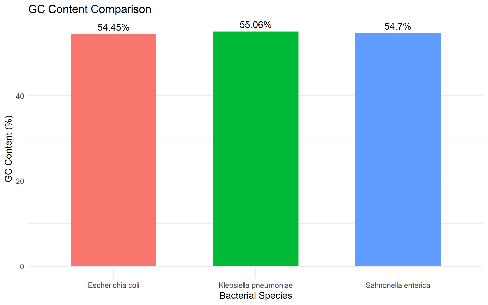
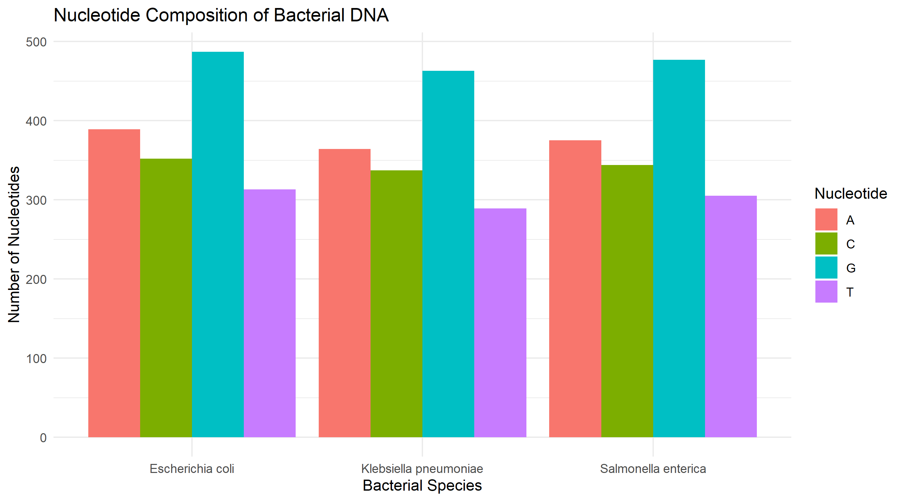
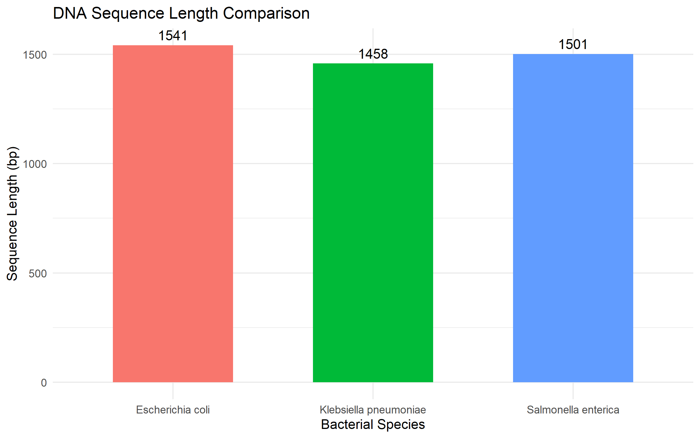

---
title: "Comparative DNA Sequence Analysis of Selected Bacterial Species"
author: "Jathusika Sabunthararajan"
date: "November 2026"
output:
  html_document:
    toc: true
    toc_depth: 2
    theme: readable
---

# 1. Introduction

Bioinformatics combines biology, computer science and statistics to analyse biological data.

This project focuses on the comparative analysis of 16S ribosomal RNA (16S rRNA) gene sequences from three bacterial species: Escherichia coli, Salmonella enterica and Klebsiella pneumoniae.

The main purpose is to compare DNA sequence length, nucleotide composition and GC content using R programming.

# 2. Research Objectives

The objectives of this project are:

1. To collect bacterial DNA sequences from NCBI.
2. To import FASTA sequences using Biostrings.
3. To calculate DNA sequence lengths.
4. To calculate nucleotide frequencies.
5. To compare GC content percentages.
6. To visualise the results using graphs.

# 3. Dataset Description

The sequences were collected from the NCBI nucleotide database.

| Bacterial Species | Accession Number |
|---|---|
| Escherichia coli | J01859.1 |
| Salmonella enterica | MG869135.1 |
| Klebsiella pneumoniae | X93214.1 |

The sequences were downloaded in FASTA format.

# 4. Methodology

The analysis was performed using RStudio.

The Biostrings package was used to import and analyse DNA sequences. The ggplot2 package was used to create graphical visualisations.

The analysis included:

- Sequence length calculation.
- Nucleotide frequency analysis.
- GC content calculation.
- Identification of ambiguous nucleotide positions.

# 5. Results

## 5.1 DNA Sequence Analysis

```{r setup, include=FALSE}
knitr::opts_chunk$set(echo=FALSE, warning=FALSE, message=FALSE)

library(knitr)

dna_results <- read.csv("results/dna_analysis_results.csv")
```

```{r results-table}
kable(dna_results, caption="DNA Sequence Analysis Results")
```

## 5.2 GC Content Comparison

The following graph compares the GC content of the three bacterial sequences.

```{r gc-graph, out.width="85%"}

```

## 5.3 Nucleotide Composition

This graph presents the frequency of Adenine, Thymine, Guanine and Cytosine.

```{r nucleotide-graph, out.width="85%"}

```

## 5.4 DNA Sequence Length

This graph compares the total sequence lengths of the selected bacterial species.

```{r length-graph, out.width="85%"}

```

# 6. Discussion

The analysis showed that Klebsiella pneumoniae had the highest GC content at 55.06%, while Escherichia coli had the lowest GC content at 54.45%.

Escherichia coli had the longest sequence, containing 1541 nucleotide positions.

Guanine was the most frequently occurring nucleotide in all three sequences.

Five ambiguous nucleotide positions were identified in the Klebsiella pneumoniae sequence. These positions were excluded from the GC content denominator.

The three bacterial sequences showed relatively similar GC percentages.

# 7. Limitations

This project analysed only three bacterial 16S rRNA gene sequences.

The analysis focused on nucleotide composition and sequence length. Multiple sequence alignment and phylogenetic analysis were not included.

# 8. Conclusion

This project demonstrated how R programming and bioinformatics packages can be used to analyse bacterial DNA sequences.

The analysis successfully compared sequence length, nucleotide frequency and GC content among three selected bacterial species.

The results provide basic insights into comparative bacterial DNA sequence analysis.

# 9. References

1. NCBI Nucleotide Database: https://www.ncbi.nlm.nih.gov/nuccore/

2. Biostrings: https://bioconductor.org/packages/Biostrings/

3. ggplot2: https://ggplot2.tidyverse.org/
