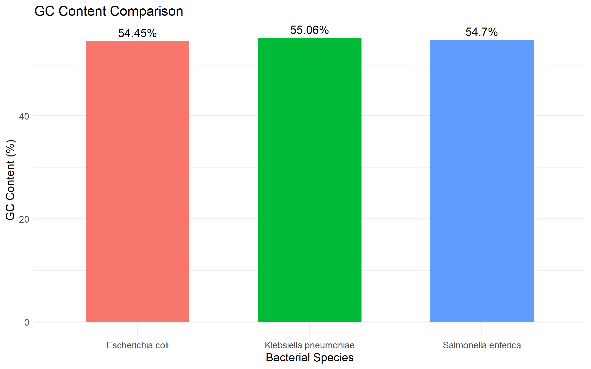
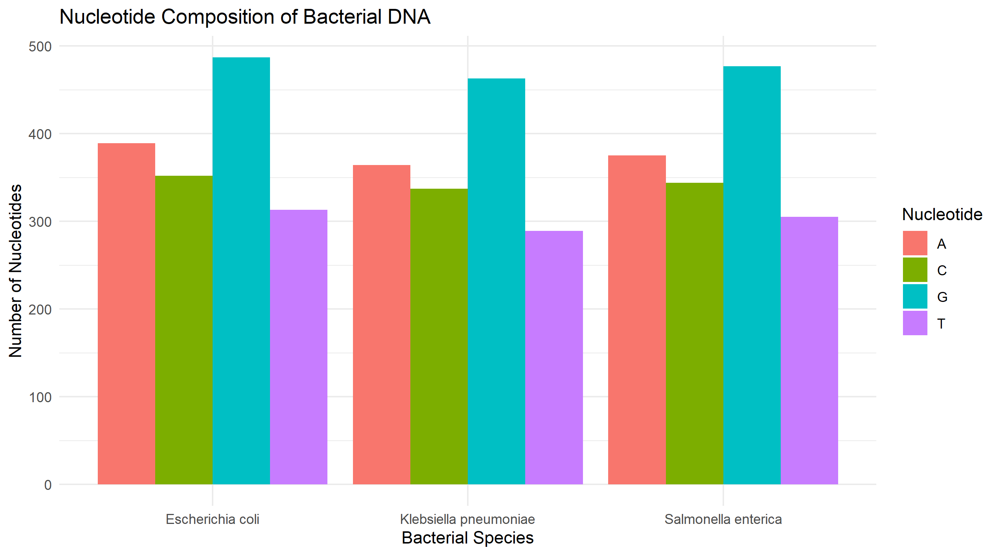
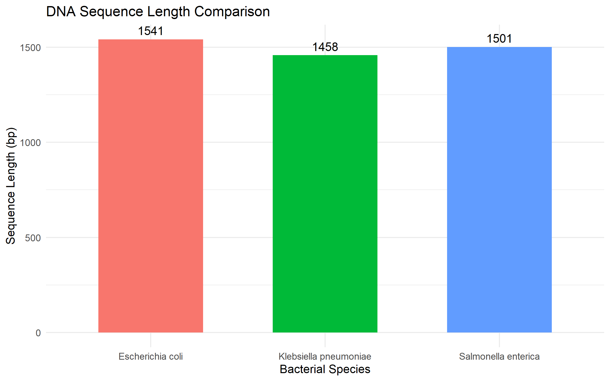

# Comparative DNA Sequence Analysis of Selected Bacterial Species Using R

## 1. Abstract

This project focuses on the comparative analysis of 16S ribosomal RNA (16S rRNA) gene sequences from three bacterial species: *Escherichia coli*, *Salmonella enterica*, and *Klebsiella pneumoniae*. The main aim is to examine differences in nucleotide composition, sequence length, and GC content using the R programming language. DNA sequences were collected from the National Center for Biotechnology Information (NCBI) database in FASTA format. The sequences were analysed using the Biostrings package, and graphical visualisations were created using ggplot2. The results showed that *Klebsiella pneumoniae* had the highest GC content (55.06%), while *Escherichia coli* had the longest sequence (1,541 bp). This project demonstrates how R-based bioinformatics techniques can be used to analyse and compare bacterial DNA sequences.

## 2. Introduction

Bioinformatics is an important field that combines biology, computer science, and statistics to analyse biological data. It helps researchers understand genetic information and identify differences between biological organisms.

DNA (Deoxyribonucleic Acid) contains the genetic information of living organisms. DNA is made up of four nucleotide bases: Adenine (A), Thymine (T), Guanine (G), and Cytosine (C). Analysing the distribution of these bases can provide useful information about the composition of DNA sequences.

The 16S ribosomal RNA (16S rRNA) gene is commonly used in bacterial identification and classification because it contains conserved and variable regions. Comparing 16S rRNA sequences can help researchers study similarities and differences among bacterial organisms.

In this project, three bacterial species were selected: *Escherichia coli*, *Salmonella enterica*, and *Klebsiella pneumoniae*. Their 16S rRNA gene sequences were collected from the NCBI database and analysed using RStudio.

The analysis focuses on sequence length, nucleotide frequency, and GC content. Graphical visualisations are also used to present the results clearly.

## 3. Research Aim and Objectives

### 3.1 Research Aim

The main aim of this project is to perform comparative DNA sequence analysis of selected bacterial species using the R programming language.

### 3.2 Research Objectives

The specific objectives are:

1. To obtain bacterial 16S rRNA gene sequences from the NCBI database.
2. To import DNA sequences into RStudio using the Biostrings package.
3. To calculate the length of each DNA sequence.
4. To identify the frequency of A, T, G, and C nucleotides.
5. To calculate and compare GC content percentages.
6. To visualise the analytical results using graphs.
7. To interpret the findings and identify differences in nucleotide composition among the selected bacterial sequences.

## 4. Dataset Description

### 4.1 Data Source

The DNA sequences used in this project were obtained from the National Center for Biotechnology Information (NCBI) nucleotide database.

NCBI is a public biological database that provides access to nucleotide sequences and other biological information.

Website: https://www.ncbi.nlm.nih.gov/

The sequences were downloaded in FASTA format.

### 4.2 Selected Bacterial Species

Three bacterial species were selected for this analysis.

| Bacterial Species | Accession Number | Sequence Length |
|---|---|---:|
| Escherichia coli | J01859.1 | 1541 bp |
| Salmonella enterica | MG869135.1 | 1501 bp |
| Klebsiella pneumoniae | X93214.1 | 1458 bp |

### 4.3 Dataset Description

The dataset contains three bacterial 16S rRNA gene sequences. Each sequence consists of nucleotide bases represented by the letters A, T, G, and C, along with possible ambiguous nucleotide symbols.

The dataset was stored in FASTA format and imported into RStudio for further analysis.

The following variables were examined:

- Sequence length: Total number of nucleotide positions.
- Adenine (A): Number of adenine bases.
- Thymine (T): Number of thymine bases.
- Guanine (G): Number of guanine bases.
- Cytosine (C): Number of cytosine bases.
- GC content: Percentage of guanine and cytosine bases among the confirmed A, T, G, and C bases.
- Ambiguous bases: Number of nucleotide positions that could not be identified as A, T, G, or C.

### 4.4 Data Format

FASTA is a commonly used file format for storing biological sequences. Each FASTA record contains a header beginning with the greater-than symbol (>) followed by the nucleotide sequence.

The three downloaded files were:

- ecoli.fasta
- salmonella.fasta
- klebsiella.fasta

All three files were stored in the project's data folder.

## 5. Methodology

### 5.1 Development Environment

The project was developed using RStudio and the R programming language. R was selected because it provides several packages for biological sequence analysis, statistical calculations, and data visualisation.

The main packages used in this project were:

| Package | Purpose |
|---|---|
| Biostrings | Import and analyse DNA sequences |
| ggplot2 | Create graphical visualisations |
| BiocManager | Install Bioconductor packages |

Base R functions were also used for data organisation, calculations, and exporting results.

### 5.2 Data Collection

The three bacterial 16S rRNA gene sequences were collected from the NCBI nucleotide database.

The selected accession numbers were J01859.1, MG869135.1, and X93214.1.

The sequences were retrieved in FASTA format using the NCBI sequence retrieval service and stored in the data folder.

### 5.3 Data Import

The Biostrings package was used to read the downloaded FASTA files into RStudio.

The `readDNAStringSet()` function was used to import each DNA sequence.

Three R objects were created:

- `ecoli`
- `salmonella`
- `klebsiella`

These objects were used in the following analysis steps.

### 5.4 Sequence Length Analysis

The `width()` function from Biostrings was used to calculate the length of each DNA sequence.

The length represents the total number of nucleotide positions in each sequence.

The calculated lengths were stored in a comparison table for further analysis.

### 5.5 Nucleotide Frequency Analysis

The `letterFrequency()` function was used to calculate the number of Adenine, Thymine, Guanine, and Cytosine bases in each sequence.

The nucleotide frequencies were used to understand the composition of the selected bacterial DNA sequences.

### 5.6 GC Content Calculation

GC content represents the percentage of Guanine and Cytosine bases in a DNA sequence.

The following formula was used:

**GC Content (%) = ((G + C) / (A + T + G + C)) × 100**

Only confirmed A, T, G, and C bases were included in the denominator.

This approach prevents ambiguous nucleotide positions from being treated as confirmed bases.

### 5.7 Handling Ambiguous Nucleotides

During the sequence analysis, ambiguous nucleotide symbols were identified using the `alphabetFrequency()` function.

The Klebsiella pneumoniae sequence contained five ambiguous positions. These included M, W, S, and Y.

These symbols represent possible nucleotide combinations according to the IUPAC nucleotide code system.

The ambiguous positions were excluded from the GC percentage denominator but included in the total sequence length.

### 5.8 Data Visualisation

The ggplot2 package was used to create three graphical visualisations:

1. GC content comparison between the three bacterial species.
2. Nucleotide composition comparison showing A, T, G, and C frequencies.
3. DNA sequence length comparison.

The graphs were saved in PNG format inside the results/graphs folder.

### 5.9 Result Storage

The final analytical results were organised into a data frame named `dna_results`.

The results were exported into a CSV file using the `write.csv()` function.

The output file was saved as `dna_analysis_results.csv` in the results folder.

## 6. Results

### 6.1 Sequence Length Results

The sequence length analysis showed differences among the three bacterial sequences.

| Bacterial Species | Sequence Length |
|---|---:|
| Escherichia coli | 1541 bp |
| Salmonella enterica | 1501 bp |
| Klebsiella pneumoniae | 1458 bp |

*Escherichia coli* had the longest sequence, containing 1,541 nucleotide positions. *Klebsiella pneumoniae* had the shortest sequence, containing 1,458 positions.

### 6.2 Nucleotide Frequency Results

The nucleotide frequency analysis produced the following results:

| Species | A | T | G | C |
|---|---:|---:|---:|---:|
| Escherichia coli | 389 | 313 | 487 | 352 |
| Salmonella enterica | 375 | 305 | 477 | 344 |
| Klebsiella pneumoniae | 364 | 289 | 463 | 337 |

Guanine (G) was the most frequently occurring nucleotide in all three sequences.

The results show that nucleotide composition varies among the selected bacterial sequences.

### 6.3 GC Content Results

The calculated GC percentages were:

| Bacterial Species | GC Content |
|---|---:|
| Escherichia coli | 54.45% |
| Salmonella enterica | 54.70% |
| Klebsiella pneumoniae | 55.06% |

*Klebsiella pneumoniae* showed the highest GC content at 55.06%, while *Escherichia coli* showed the lowest GC content at 54.45%.

The three sequences showed relatively similar GC percentages.

### 6.4 Ambiguous Nucleotide Results

The analysis identified the following ambiguous nucleotide counts:

| Bacterial Species | Ambiguous Bases |
|---|---:|
| Escherichia coli | 0 |
| Salmonella enterica | 0 |
| Klebsiella pneumoniae | 5 |

The Klebsiella pneumoniae sequence contained five ambiguous nucleotide positions. The other two sequences contained only the four standard DNA bases.

### 6.5 Graphical Results

#### Graph 1: GC Content Comparison

This graph compares the GC content percentages of the three selected bacterial sequences. Klebsiella pneumoniae has the highest GC content, followed by Salmonella enterica and Escherichia coli.

#### Graph 2: Nucleotide Composition

This graph presents the number of A, T, G, and C nucleotides in each bacterial sequence. Guanine is the most frequently occurring nucleotide in all three sequences.

#### Graph 3: DNA Sequence Length Comparison

This graph compares the total nucleotide positions in each sequence. Escherichia coli has the longest sequence, while Klebsiella pneumoniae has the shortest.

## 7. Discussion

The main purpose of this project was to compare the nucleotide composition, sequence length, and GC content of three selected bacterial 16S rRNA gene sequences.

The results showed that the GC content values were relatively similar among the selected sequences. Klebsiella pneumoniae had the highest GC content at 55.06%, while Escherichia coli had the lowest value at 54.45%. This indicates that the selected sequences have similar overall GC proportions.

The nucleotide frequency analysis showed that Guanine was the most common nucleotide in all three sequences. This demonstrates that nucleotide composition can be examined and compared using simple bioinformatics techniques in R.

The sequence length analysis identified differences among the three records. Escherichia coli had the longest sequence, followed by Salmonella enterica and Klebsiella pneumoniae. These differences describe the lengths of the selected database records and do not represent the complete genome sizes of the bacteria.

Another important observation was the presence of five ambiguous nucleotide positions in the Klebsiella pneumoniae sequence. These positions were identified using the Biostrings package. Handling ambiguous nucleotide symbols correctly was important to ensure an accurate GC content calculation.

The graphical visualisations made it easier to compare the analytical results. The bar charts clearly presented differences in GC content, nucleotide frequencies, and sequence lengths.

Overall, the project demonstrates how publicly available biological sequence data can be analysed using R programming and bioinformatics packages.

However, the analysis is limited to nucleotide composition and sequence length. It does not establish evolutionary relationships or explain differences in bacterial characteristics.

## 8. Limitations

Although the project successfully completed the planned sequence analysis, several limitations should be considered.

1. Only three bacterial 16S rRNA gene sequences were included in the analysis.
2. The sequences were obtained from different NCBI records and represent specific deposited records.
3. The sequence lengths were different, which should be considered when comparing nucleotide frequencies.
4. Five ambiguous nucleotide positions were identified in the Klebsiella pneumoniae sequence.
5. The analysis focused on nucleotide composition and did not include multiple sequence alignment or phylogenetic tree construction.
6. The findings are descriptive and should not be used to make conclusions about the complete genomes or biological characteristics of the selected bacteria.

Future work could include analysing more bacterial sequences, performing multiple sequence alignment, identifying conserved regions, and constructing phylogenetic trees.

## 9. Conclusion

This project successfully performed comparative DNA sequence analysis of three bacterial species using RStudio.

The 16S rRNA gene sequences of Escherichia coli, Salmonella enterica, and Klebsiella pneumoniae were obtained from the NCBI database and analysed using the Biostrings package.

The analysis included sequence length calculation, nucleotide frequency analysis, and GC content calculation. Three graphs were also generated using ggplot2 to present the results.

The findings showed that Klebsiella pneumoniae had the highest GC content (55.06%), whereas Escherichia coli had the longest sequence (1,541 bp). Guanine was the most frequently occurring nucleotide in all three sequences.

The project demonstrates the usefulness of R programming for basic bioinformatics analysis and provides practical experience in collecting, processing, analysing, and visualising biological sequence data.

## 10. Reproducibility

The project was developed using RStudio and the R programming language.

To reproduce the analysis:

1. Download or clone the project repository.
2. Open the `Bacterial_DNA_Sequence_Analysis.Rproj` file in RStudio.
3. Ensure the required R packages are installed.
4. Keep the FASTA files inside the data folder.
5. Run the R analysis script in the code folder from beginning to end.
6. Check the generated CSV file in the results folder.
7. View the generated graphs inside results/graphs.

### Required R Packages

- Biostrings
- BiocManager
- ggplot2

The analysis script contains the commands used to import, analyse, and visualise the DNA sequences.

## 11. References

1. National Center for Biotechnology Information (NCBI). Nucleotide Database. https://www.ncbi.nlm.nih.gov/nuccore/

2. NCBI Sequence Retrieval Service (E-utilities). https://www.ncbi.nlm.nih.gov/books/NBK25501/

3. Bioconductor. Biostrings: Efficient manipulation of biological strings. https://bioconductor.org/packages/Biostrings/

4. Wickham, H. (2016). ggplot2: Elegant Graphics for Data Analysis. Springer. https://ggplot2.tidyverse.org/

### Sequence Records

- Escherichia coli – J01859.1: https://www.ncbi.nlm.nih.gov/nuccore/J01859.1
- Salmonella enterica – MG869135.1: https://www.ncbi.nlm.nih.gov/nuccore/MG869135.1
- Klebsiella pneumoniae – X93214.1: https://www.ncbi.nlm.nih.gov/nuccore/X93214.1